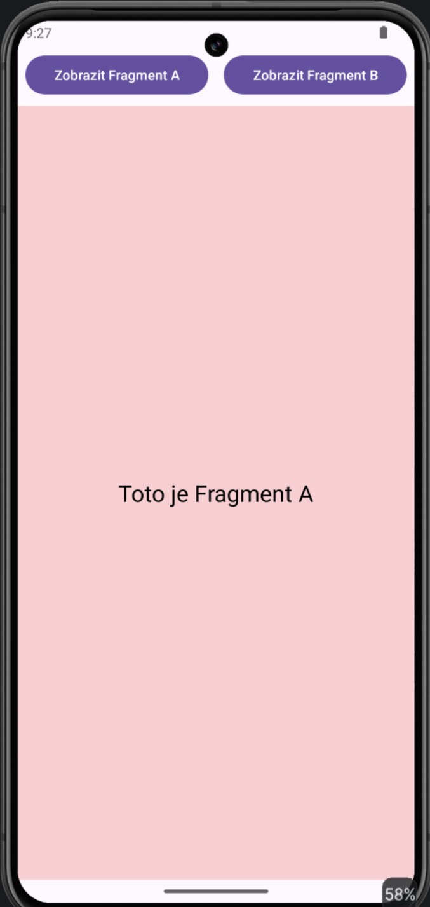
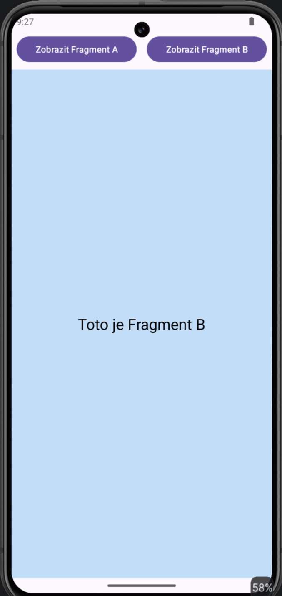

# MyApp007aFragments – Fragmenty (základ)

Úkol 007, aplikace A: dvě tlačítka, každé zobrazí jiný prázdný fragment.

- `activity_main.xml` – `ConstraintLayout` s řádkem tlačítek (`btnFragmentA`, `btnFragmentB`) a kontejnerem `FragmentContainerView` (`fragmentContainer`).
- `FragmentA` / `FragmentB` – prázdné fragmenty, liší se jen textem a barvou pozadí (růžová / modrá).
- `MainActivity` – po kliknutí vymění obsah kontejneru přes `supportFragmentManager.beginTransaction().replace(...).commit()`; po spuštění se zobrazí Fragment A.
- Propojení tlačítek přes ViewBinding.

## Screenshoty

| Fragment A | Fragment B |
|---|---|
|  |  |
