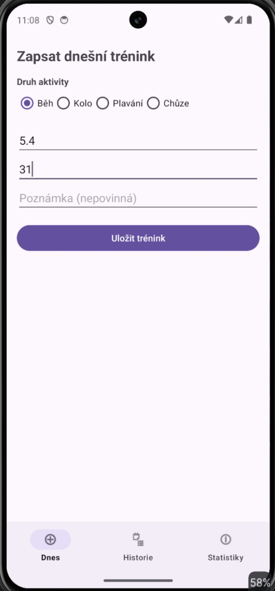
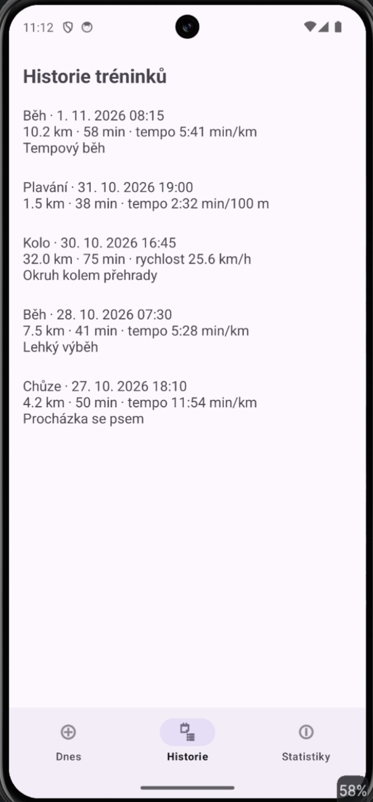
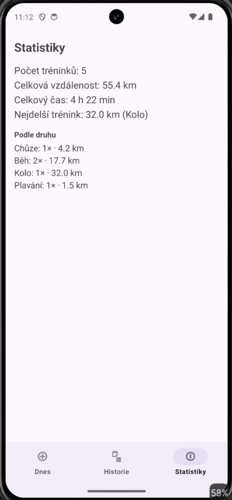

# MyApp007bFragmentsExample1 – Tréninkový deník

Úkol 007, aplikace B: vlastní aplikace postavená na fragmentech – jednoduchý deník sportovních tréninků.

## Fragmenty

| Fragment | Co dělá |
|---|---|
| **Dnes** (`TodayFragment`) | formulář pro zápis tréninku – druh aktivity (běh, kolo, plavání, chůze), vzdálenost, čas, poznámka; kontrola vstupů |
| **Historie** (`HistoryFragment`) | seznam všech tréninků od nejnovějšího, u každého datum, km, čas a výkon podle druhu: tempo min/km (běh, chůze), rychlost km/h (kolo), tempo min/100 m (plavání); tlačítko **Načíst ukázkové tréninky** pro rychlé vyzkoušení |
| **Statistiky** (`StatsFragment`) | počet tréninků, celková vzdálenost a čas, nejdelší trénink a souhrn podle druhu aktivity |

## Jak to funguje

- `MainActivity` obsahuje `FragmentContainerView` a spodní navigaci `BottomNavigationView`; výběr položky vymění fragment přes `supportFragmentManager.beginTransaction().replace(...)`.
- Data sdílí všechny fragmenty přes jednoduché úložiště `TrainingRepository` (objekt v paměti) – co se zapíše ve fragmentu Dnes, hned se ukáže v Historii i ve Statistikách.
- Historie a Statistiky se obnovují v `onResume()`, takže vždy ukazují aktuální data.
- Všechny fragmenty používají ViewBinding (`_binding` se uvolní v `onDestroyView()`).

## Screenshoty

| Dnes | Historie | Statistiky |
|---|---|---|
|  |  |  |
