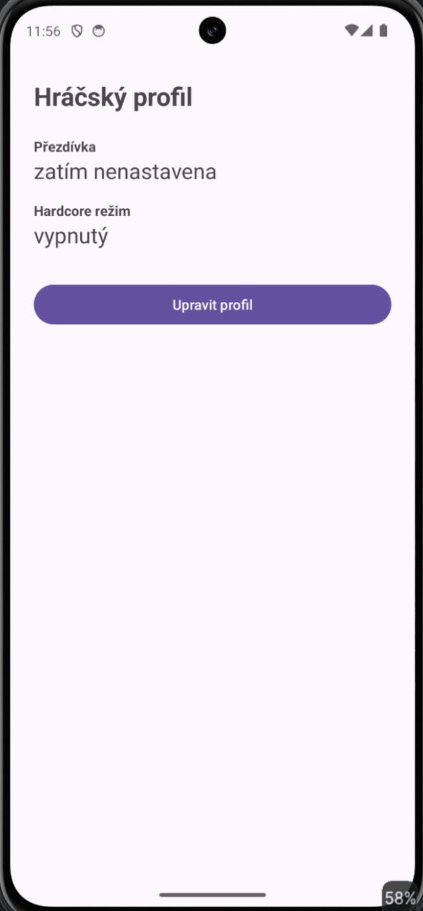
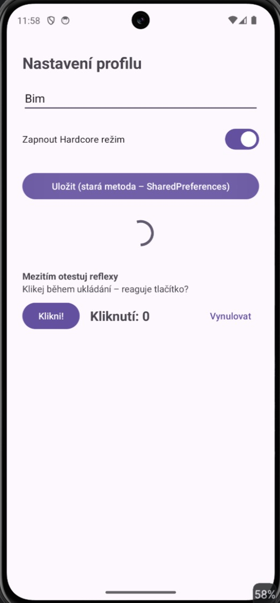
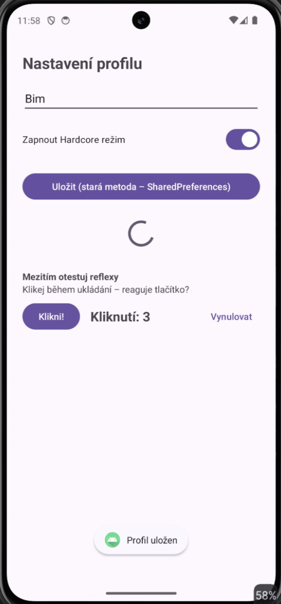
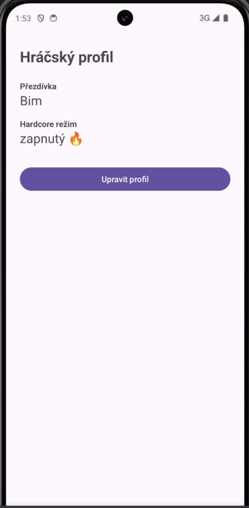

# MyApp008aSharedPref – Hráčský profil (SharedPreferences)

Úkol 008, aplikace A: hráčský profil uložený přes **SharedPreferences**, tedy „starou metodu“, která ukládá synchronně na hlavním (UI) vlákně.

## Obrazovky

| Fragment | Co dělá |
|---|---|
| **Dashboard** (`DashboardFragment`) | ukazuje uloženou přezdívku a stav Hardcore režimu, tlačítko **Upravit profil** |
| **Nastavení** (`SettingsFragment`) | pole pro přezdívku, přepínač Hardcore režimu (`MaterialSwitch`), tlačítko **Uložit (stará metoda – SharedPreferences)** |

## Jak to funguje

- `MainActivity` obsahuje `FrameLayout`; fragmenty se vyměňují přes `replace(...)` a `addToBackStack(null)`, takže systémové Zpět vrátí na Dashboard.
- `ProfilePrefs` drží název souboru (`gamer_profile`) a klíče (`nickname`, `hardcore_mode`).
- Ukládání simuluje pomalý zápis:
  ```kotlin
  Thread.sleep(3000)                     // blokuje hlavní vlákno
  prefs.edit()
      .putString(KEY_NICKNAME, nickname)
      .putBoolean(KEY_HARDCORE, hardcore)
      .commit()                          // synchronní zápis
  ```
- Dashboard načítá hodnoty v `onResume()`.

## Návazný úkol – test reflexů

Pod tlačítkem Uložit je počítadlo **Klikni!** / **Kliknutí: N** / **Vynulovat** a stále se točící `ProgressBar`.

- Během `Thread.sleep(3000)` aplikace **zamrzne**: kolečko se zastaví, počítadlo zůstává na 0 a tlačítka nereagují.
- Kliknutí udělaná během zamrznutí systém zpracuje až po skončení ukládání, proto počítadlo najednou skočí (tady na 3) a zároveň se objeví Toast „Profil uložen“.
- Kdyby blokování trvalo přes 5 s, Android by ukázal dialog ANR („Aplikace nereaguje“).

Porovnání s neblokujícím řešením: [MyApp008bDataStore](../MyApp008bDataStore).

## Screenshoty

| Prázdný profil | Během ukládání (zamrzlé) | Po uložení | Po restartu aplikace |
|---|---|---|---|
|  |  |  |  |
