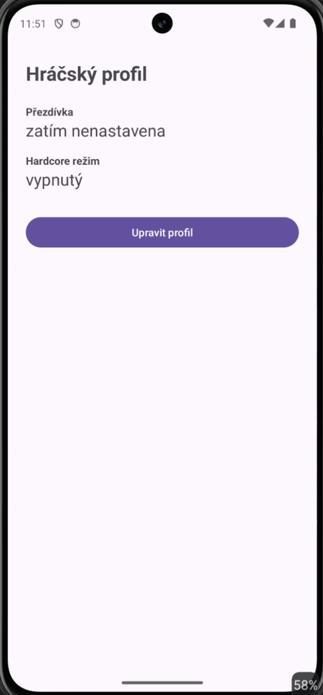
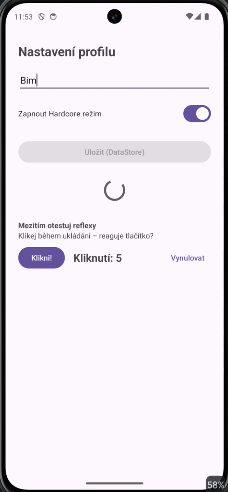
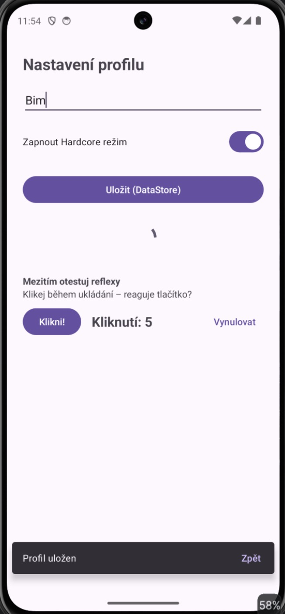
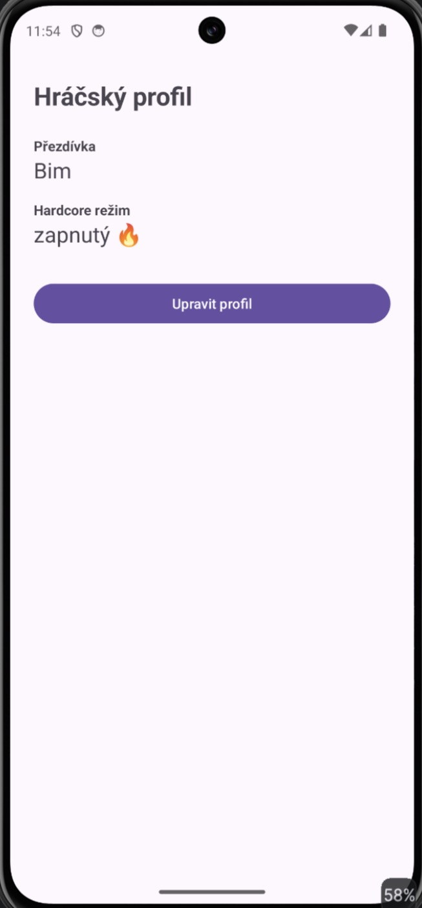

# MyApp008bDataStore – Hráčský profil (DataStore)

Úkol 008, aplikace B: stejný hráčský profil jako v [MyApp008aSharedPref](../MyApp008aSharedPref), ale uložený přes **Jetpack DataStore (Preferences)** v coroutine, takže UI se nikdy nezablokuje.

## Obrazovky

| Fragment | Co dělá |
|---|---|
| **Dashboard** (`DashboardFragment`) | ukazuje uloženou přezdívku a Hardcore režim, data sleduje živě přes `Flow` |
| **Nastavení** (`SettingsFragment`) | přezdívka, přepínač Hardcore režimu, tlačítko **Uložit (DataStore)** |

## Jak to funguje

- Závislost `androidx.datastore:datastore-preferences:1.1.1` (verze v `gradle/libs.versions.toml`).
- `ProfileStore`:
  - `val Context.dataStore by preferencesDataStore(name = "gamer_profile")`,
  - typované klíče `stringPreferencesKey("nickname")` a `booleanPreferencesKey("hardcore_mode")`,
  - `profile(context): Flow<Profile>` pro čtení,
  - `suspend fun save(...)` přes `dataStore.edit { }` pro zápis.
- Ukládání v `SettingsFragment`:
  ```kotlin
  binding.btnSave.isEnabled = false
  viewLifecycleOwner.lifecycleScope.launch {
      delay(3000)                         // čeká, ale neblokuje hlavní vlákno
      ProfileStore.save(requireContext(), profile)
      binding.btnSave.isEnabled = true
      Snackbar.make(binding.settingsRoot, R.string.msg_saved, Snackbar.LENGTH_LONG)
          .setAction(R.string.action_back) { parentFragmentManager.popBackStack() }
          .show()
  }
  ```
- Dashboard sbírá `Flow` v `repeatOnLifecycle(Lifecycle.State.STARTED)`, takže se po uložení sám aktualizuje.
- Potvrzení ukazuje `Snackbar` s akcí **Zpět**, proto je kořen layoutu `CoordinatorLayout`.

## Návazný úkol – test reflexů

Stejné počítadlo **Klikni!** jako ve verzi A. Tady během ukládání kolečko běží dál a každé kliknutí se hned započítá (na screenshotu 5 kliknutí během 3 s ukládání), protože `delay()` jen uspí coroutine a hlavní vlákno zůstává volné.

## SharedPreferences × DataStore

| | SharedPreferences (A) | DataStore (B) |
|---|---|---|
| Vlákno | zápis `commit()` na hlavním vlákně | zápis v coroutine mimo hlavní vlákno |
| UI během ukládání | zamrzne, hrozí ANR | reaguje normálně |
| Čtení | jednorázově `getString()` | `Flow` – změny se propisují samy |
| Typová bezpečnost | klíče jako `String` | typované klíče `Preferences.Key<T>` |
| Chyby | výjimky se mohou ztratit | chyby jdou zachytit ve `Flow` (`catch`) |

## Screenshoty

| Prázdný profil | Během ukládání | Snackbar se Zpět | Uložený profil |
|---|---|---|---|
|  |  |  |  |
